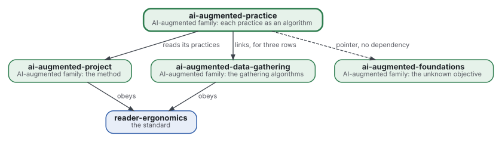
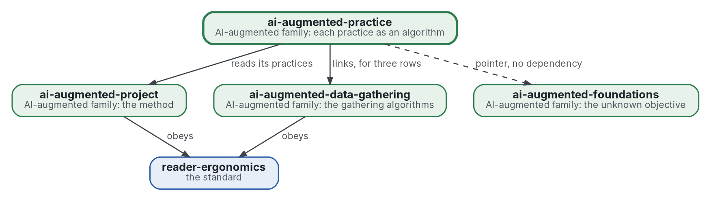

# Pratique comme algorithme

[](https://github.com/Tewf/ai-augmented-practice/actions/workflows/checks.yml)
[](https://tewf.github.io/ai-augmented-practice/)

Chaque pratique de la méthode augmentée par l'IA, lue comme un **algorithme** pour un problème nommé. Une page tient la pratique, la classe de problème qu'elle résout, le meilleur algorithme connu pour cette classe avec une implémentation de référence, l'écart entre les deux, et le changement proposé. Une page par pratique, et un tableau qu'un programme vérifie.

Cette page en anglais : [README.md](README.md). Les deux versions suivent le même état.

> **État (2026-11-03) :** mis en place ; rien n'est encore écrit au-delà du périmètre. Le premier travail est une revue
> de littérature, non commencée. Le nom est provisoire jusqu'à ce que la première étape de cette revue dise comment le
> domaine nomme la chose. Ce n'est ni une norme officielle, ni une étude relue par des pairs, ni un résultat nouveau.
>
> **Comment il est fait :** avec Claude, un assistant IA d'Anthropic, sous la direction du mainteneur, comme
> reader-ergonomics. Les corrections sont bienvenues sous forme d'issues.

## Où il se place



<details>
<summary>Graphviz source</summary>



</details>

- **Il lit [ai-augmented-project](https://github.com/Tewf/ai-augmented-project)** : la méthode est celle de ce dépôt, et chaque pratique d'ici est l'une des siennes.
- **Il lie [ai-augmented-data-gathering](https://github.com/Tewf/ai-augmented-data-gathering)** pour les lignes dont l'algorithme y vit, et pointe vers [ai-augmented-foundations](https://github.com/Tewf/ai-augmented-foundations), qui tient la théorie de l'objectif inconnu, sans en dépendre.
- **Il obéit à [reader-ergonomics](https://github.com/Tewf/reader-ergonomics/blob/4f99372093729dacf982e9174e94f6b8793c513d/standard.md)** (v1.20.0) et exécute ses vérifications en CI.
- **Il ne pointe que vers le bas.** La carte de la famille est [ai-augmented](https://github.com/Tewf/ai-augmented).

## Périmètre

| | Quoi | Pourquoi |
|---|---|---|
| dedans | la carte : une ligne par pratique, avec sa classe de problème, son meilleur algorithme connu, son implémentation de référence, son écart et le changement proposé | une pratique qui est un algorithme se compare au meilleur ; un seul tableau garde la comparaison en un lieu |
| dedans | la vérification de la carte : un programme qui échoue sur une cellule vide, un lien manquant ou une ligne sans référence | un tableau que personne ne vérifie se périme, et la règle de la famille est qu'un programme vérifie ce qu'il peut |
| dedans | une page par pratique, ouverte depuis sa ligne | une ligne tient le verdict ; la page tient le raisonnement qui y mène |
| plus tard | chaque changement proposé, exécuté sur un cas réel | un changement reste une affirmation tant qu'un cas ne le mesure pas ; les cas sont ceux d'[ai-augmented-cases](https://github.com/Tewf/ai-augmented-cases) |
| dehors | les algorithmes eux-mêmes, avec leur code | chacun vit dans son propre dépôt et est lié depuis sa ligne |
| dehors | la méthode à laquelle les pratiques appartiennent | [ai-augmented-project](https://github.com/Tewf/ai-augmented-project) |
| dehors | la théorie d'un objectif qui n'est pas connu d'avance | [ai-augmented-foundations](https://github.com/Tewf/ai-augmented-foundations) |

## Le premier travail : une revue de littérature

Non commencée. Elle suit l'ordre d'une revue de thèse, et elle est finie quand elle peut nommer la référence.

Les douze premières lignes de la carte, tirées de la liste de pratiques du mainteneur. La classe de problème est une piste à vérifier, pas un résultat :

| Pratique | Classe de problème (une piste) |
|---|---|
| cadrage et revue | un problème de décision séquentielle |
| collecte de données | la quête d'information (ligne tenue par data-gathering) |
| arrêt | l'estimation de ce qui reste invisible (ligne tenue par data-gathering) |
| boule de neige | le parcours d'un graphe de citations |
| sources payantes | la valeur de l'information (ligne tenue par data-gathering) |
| lecture approfondie | l'apprentissage actif |
| passages par bras | le test séquentiel et le plan factoriel |
| niveaux | l'optimisation multi-fidélité |
| lots | l'ordonnancement avec précédences |
| le plafond de budget | l'allocation sous budget |
| protocole avant l'exécution | la préinscription |
| mémoire | le transfert |

1. **Cadrer :** le problème en une phrase, et comment chaque domaine le nomme. Pistes à vérifier : la décision algorithmique, la recherche opérationnelle du travail de connaissance, l'analyse de décision, et la littérature des heuristiques et des biais opposée aux algorithmes. Le dépôt peut être renommé alors.
2. **Revue :** chaque nom, cherché par son nom académique, son acronyme et son auteur ; les synthèses d'abord.
   - le meilleur algorithme connu pour chaque classe de problème, par son nom académique, son acronyme et son auteur, les synthèses d'abord ;
   - là où une implémentation de référence existe, trouvée sous le nom de l'auteur avant d'écrire qu'elle manque ;
   - là où des personnes ont été mesurées contre des algorithmes sur le même problème, et qui a gagné.
3. **État de l'art, et le dossier contre.**
4. **Positionnement :** ce que ce dépôt demande et que le domaine ne répond pas déjà.
5. **Référence :** les douze pratiques telles que le mainteneur les mène aujourd'hui, écrites ligne par ligne, et comparées au meilleur algorithme que la revue a trouvé pour chacune.

## Questions auxquelles la revue doit répondre

- **Algorithme ou habitude.** Quelles pratiques ont une classe de problème assez bien posée pour nommer un algorithme, et lesquelles sont des habitudes qu'aucun domaine n'a formalisées ?
- **L'écart.** Pour chaque ligne, à quelle distance la pratique du mainteneur est-elle du meilleur algorithme connu, mesurée comment ?
- **Personnes contre algorithmes.** Où la littérature trouve-t-elle une personne de jugement qui bat l'algorithme, et qu'en suit-il sur les lignes à laisser telles quelles ?
- **La vérification.** Que doit lire un programme dans une ligne pour décider qu'elle est complète, et que ne peut-il jamais décider ?

## Vérifier

```sh
git clone https://github.com/Tewf/reader-ergonomics
python3 reader-ergonomics/checks/run.py chemin/vers/ce/depot
```

La CI exécute les mêmes vérifications à chaque push, et une exécution échoue à la première erreur
([checks.yml](https://github.com/Tewf/ai-augmented-practice/blob/master/.github/workflows/checks.yml)). Chaque push sur
master construit aussi le site, [tewf.github.io/ai-augmented-practice](https://tewf.github.io/ai-augmented-practice/)
([pages.yml](https://github.com/Tewf/ai-augmented-practice/blob/master/.github/workflows/pages.yml)).

## Contenu

| Partie | Résumé |
|---|---|
| [decisions](decisions/) | une fiche par choix qui façonne ce dépôt, chacune ouvrant sur la décision en une phrase |

## Licence

Code sous [Apache License 2.0](LICENSE) ; prose sous [CC BY 4.0](LICENSES/CC-BY-4.0.txt). Réutilisez-le comme vous le
souhaitez, en créditant ce dépôt ; [CITATION.cff](CITATION.cff) donne une citation si besoin.
