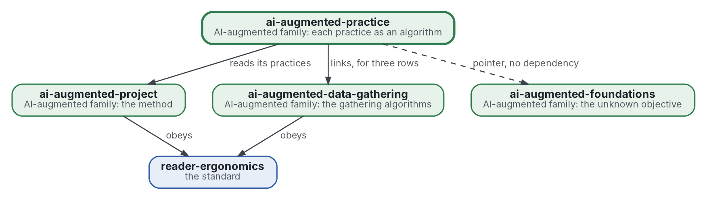

# Pratique comme algorithme

[](https://github.com/Tewf/ai-augmented-practice/actions/workflows/checks.yml)
[](https://tewf.github.io/ai-augmented-practice/)

Chaque pratique de la méthode augmentée par l'IA, lue comme un **algorithme** pour un problème nommé. Une page tient la pratique, la classe de problème qu'elle résout, le meilleur algorithme connu pour cette classe avec une implémentation de référence, l'écart entre les deux, et le changement proposé. Une page par pratique, et un tableau qu'un programme vérifie.

Cette page en anglais : [README.md](README.md). Les deux versions suivent le même état.

> **État (2026-11-03) :** version 0.1.0. Fait : la première passe de la revue, 40 sources lues par résumé ou notice, les
> douze lignes de la carte avec une page chacune, un tableau vérifié par un programme (16 tests unitaires) et une
> référence nommée. Ouvert : aucun texte intégral lu, aucun changement proposé essayé sur un cas réel, et les lignes de
> la collecte attendent la revue de ce dépôt. Aucun domaine ne porte un nom unique pour cela, et le nom reste. Ce n'est
> ni une norme officielle, ni une étude relue par des pairs, ni un résultat nouveau.
>
> **Comment il est fait :** avec Claude, un assistant IA d'Anthropic, sous la direction du mainteneur, comme
> reader-ergonomics. Les corrections sont bienvenues sous forme d'issues.

## Où il se place


<details>
<summary>Graphviz source</summary>



</details>

- **Il lit [ai-augmented-project](https://github.com/Tewf/ai-augmented-project)** : la méthode est celle de ce dépôt, et chaque pratique d'ici est l'une des siennes.
- **Il lie [ai-augmented-data-gathering](https://github.com/Tewf/ai-augmented-data-gathering)** pour les lignes dont l'algorithme y vit, et pointe vers [ai-augmented-foundations](https://github.com/Tewf/ai-augmented-foundations), qui tient la théorie de l'objectif inconnu, sans en dépendre.
- **Il obéit à [reader-ergonomics](https://github.com/Tewf/reader-ergonomics/blob/4f99372093729dacf982e9174e94f6b8793c513d/standard.md)** (v1.20.0) et exécute ses vérifications en CI.
- **Il ne pointe que vers le bas.** La carte de la famille est [ai-augmented](https://github.com/Tewf/ai-augmented).

## Périmètre

| | Quoi | Pourquoi |
|---|---|---|
| dedans | la carte : une ligne par pratique, avec sa classe de problème, son meilleur algorithme connu, son implémentation de référence, son écart et le changement proposé | une pratique qui est un algorithme se compare au meilleur ; un seul tableau garde la comparaison en un lieu |
| dedans | la vérification de la carte : un programme qui échoue sur une cellule vide, un lien manquant ou une ligne sans référence | un tableau que personne ne vérifie se périme, et la règle de la famille est qu'un programme vérifie ce qu'il peut |
| dedans | une page par pratique, ouverte depuis sa ligne | une ligne tient le verdict ; la page tient le raisonnement qui y mène |
| plus tard | chaque changement proposé, exécuté sur un cas réel | un changement reste une affirmation tant qu'un cas ne le mesure pas ; les cas sont ceux d'[ai-augmented-cases](https://github.com/Tewf/ai-augmented-cases) |
| dehors | les algorithmes eux-mêmes, avec leur code | chacun vit dans son propre dépôt et est lié depuis sa ligne |
| dehors | la méthode à laquelle les pratiques appartiennent | [ai-augmented-project](https://github.com/Tewf/ai-augmented-project) |
| dehors | la théorie d'un objectif qui n'est pas connu d'avance | [ai-augmented-foundations](https://github.com/Tewf/ai-augmented-foundations) |

## La carte

Douze lignes, une page chacune : [la carte](map/README.md). La pratique est celle du mainteneur, écrite pour cette revue.

| Pratique | Classe de problème | Algorithme | Adéquation |
|---|---|---|---|
| [portée et revue](map/scope-and-review.md) | problème de décision séquentielle | gradient de connaissance | en partie |
| [collecte](map/data-gathering.md) | recherche d'information (foraging) | règle de la valeur marginale, échantillonnage de Thompson | algorithme |
| [arrêt](map/stopping.md) | estimer ce qui reste invisible | estimation de couverture | algorithme |
| [boule de neige](map/snowballing.md) | parcours d'un graphe de citations | suivi de citations, frontière classée | algorithme |
| [sources payantes](map/paywalled-sources.md) | valeur de l'information | valeur attendue de l'information | algorithme |
| [lecture approfondie](map/deep-reading.md) | apprentissage actif | échantillonnage par incertitude | algorithme |
| [essais par bras](map/runs-per-arm.md) | test séquentiel, plan factoriel | séquences de confiance | algorithme |
| [niveaux](map/tiers.md) | optimisation multi-fidélité | Hyperband, cascade de modèles | algorithme |
| [lots](map/batches.md) | ordonnancement avec précédence | ordonnancement par liste, chemin critique | algorithme |
| [le plafond de budget](map/the-budget-cap.md) | allocation sous budget | optimisation bayésienne sensible au coût | en partie |
| [protocole avant l'essai](map/protocol-before-the-run.md) | préenregistrement | rapport enregistré | algorithme |
| [mémoire](map/memory.md) | transfert | niveaux de mémoire sur le raisonnement à partir de cas | habitude |

Les pages de la carte sont en anglais.

## Ce que la carte a trouvé

Première passe, 40 sources, lues par résumé ou notice. Les sources et les niveaux de preuve sont sur chaque page.

- **Aucun domaine ne nomme l'ensemble.** L'analytique de décision séquentielle (Powell 2019) nomme les lignes de décision, et l'automatisation des revues systématiques (Marshall 2019) nomme les lignes 2 à 6 ([cadrage](evidence/frame.md)). Le nom reste.
- **Onze lignes sur douze ont un problème nommé et une implémentation.** La mémoire est une habitude : le domaine a des conceptions, et aucune mesure de notes tenues par une personne. La portée et le plafond de budget sont posés mais manquent de données pour faire tourner une politique.
- **L'écart est surtout un manque de relevés, pas un meilleur algorithme.** Dix des douze changements commencent par noter une quantité dont l'algorithme a besoin : rendement par requête, niveau essayé, prédécesseurs de chaque tâche.
- **Dix essais par bras ne détectent que de grands effets.** Calculé ici. À dix essais par bras, la puissance est de 0,63 pour un taux qui passe de 0 à 0,5, et de 0,14 de 0,5 à 0,8. À soixante, elle est de 0,91 de 0,5 à 0,8, et de 0,31 de 0,5 à 0,65 ([essais par bras](map/runs-per-arm.md)).
- **Personnes contre algorithmes.** La prédiction mécanique était environ 10 % plus exacte que le jugement clinique, et le jugement clinique était nettement meilleur dans 6 % à 16 % des études (Grove 2000, résumé). L'intuition tient dans des environnements réguliers avec retour d'information (Kahneman 2009). Le choix de la profondeur de lecture, l'inclusion d'un article et ce qu'on note restent donc à la personne.

## La référence

**B1 : le protocole avant l'essai.** La pratique est déjà la procédure du domaine, le préenregistrement (Nosek 2018) : le plan et la prédiction sont écrits d'abord et un programme juge l'essai. L'écart est un horodatage par un tiers et une liste des écarts au plan. Claesen 2021 les a trouvés absents : toutes les études de son échantillon s'écartaient de leur plan, et toutes sauf une laissaient un écart non déclaré (résumé). C'est la seule ligne où la pratique du mainteneur et la meilleure procédure connue coïncident dans leur forme ([protocole avant l'essai](map/protocol-before-the-run.md)).

## Questions auxquelles la revue a répondu

- **Algorithme ou habitude.** Neuf lignes sont des algorithmes, deux sont posées mais non exécutées, et une, la mémoire, est une habitude.
- **L'écart.** Mesuré par ce que le changement relèverait ; aucun écart n'est encore en heures ou en jetons, car les relevés n'existent pas.
- **Personnes contre algorithmes.** Voir les résultats ci-dessus ; le jugement est laissé là où l'environnement est irrégulier.
- **La vérification.** Un programme lit que chaque ligne a un problème, un algorithme avec une clé qui se résout, un lien GitHub et un changement. Il ne peut pas décider qu'un algorithme est le meilleur connu ([la vérification du tableau](checks/local/map_table.py)).

## Vérifier

```sh
git clone https://github.com/Tewf/reader-ergonomics
python3 reader-ergonomics/checks/run.py chemin/vers/ce/depot
python3 -m unittest discover -s checks   # les tests de la vérification du tableau
```

La CI exécute les mêmes vérifications à chaque push, et une exécution échoue à la première erreur
([checks.yml](https://github.com/Tewf/ai-augmented-practice/blob/master/.github/workflows/checks.yml)). Chaque push sur
master construit aussi le site, [tewf.github.io/ai-augmented-practice](https://tewf.github.io/ai-augmented-practice/)
([pages.yml](https://github.com/Tewf/ai-augmented-practice/blob/master/.github/workflows/pages.yml)).

## Contenu

| Partie | Résumé |
|---|---|
| [map](map/) | douze pratiques lues chacune comme un algorithme pour un problème nommé, avec un tableau qu'un programme vérifie |
| [evidence](evidence/) | le cadrage, le protocole et la bibliographie de 40 sources |
| [decisions](decisions/) | une fiche par choix qui façonne ce dépôt |

## Licence

Code sous [Apache License 2.0](LICENSE) ; prose sous [CC BY 4.0](LICENSES/CC-BY-4.0.txt). Réutilisez-le comme vous le
souhaitez, en créditant ce dépôt ; [CITATION.cff](CITATION.cff) donne une citation si besoin.
