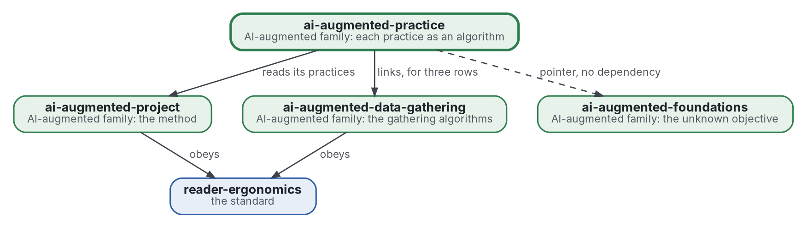

# Practice as algorithm

[](https://github.com/Tewf/ai-augmented-practice/actions/workflows/checks.yml)
[](https://tewf.github.io/ai-augmented-practice/)

Each practice of the AI-augmented method, read as an **algorithm** for a named problem. A page holds the practice, the problem class it solves, the best-known algorithm for that class with a reference implementation, the gap between the two, and the change proposed. One page per practice, and one table a program checks.

This page in French: [README.fr.md](README.fr.md).

> **Status (2026-11-03):** set up; nothing is written yet beyond the scope. The first job is a literature review, not
> started. The name is provisional until that review's first step says what the field calls this. It is not an
> official standard, not a peer-reviewed study and not a new result.
>
> **How it is made:** with Claude, an AI assistant by Anthropic, under the maintainer's direction, the way
> reader-ergonomics was made. Corrections are welcome as issues.

## Where it sits


<details>
<summary>Graphviz source</summary>



</details>

- **It reads [ai-augmented-project](https://github.com/Tewf/ai-augmented-project)**: the method is that repository's, and each practice here is one of its practices.
- **It links [ai-augmented-data-gathering](https://github.com/Tewf/ai-augmented-data-gathering)** for the rows whose algorithm lives there, and points to [ai-augmented-foundations](https://github.com/Tewf/ai-augmented-foundations), which holds the theory of the unknown objective, without depending on it.
- **It obeys [reader-ergonomics](https://github.com/Tewf/reader-ergonomics/blob/4f99372093729dacf982e9174e94f6b8793c513d/standard.md)** (v1.20.0) and runs its checks in CI.
- **It links down only.** The family's map is [ai-augmented](https://github.com/Tewf/ai-augmented).

## Scope

| | What | Why |
|---|---|---|
| in | the map: one row per practice, with its problem class, best-known algorithm, reference implementation, gap and proposed change | a practice that is an algorithm can be compared with the best one; one table keeps the comparison in one place |
| in | the check of the map: a program that fails on an empty cell, a missing link or a row with no reference | a table nobody checks goes stale, and the family's rule is that a program checks what it can |
| in | one page per practice, opened from its row | a row holds the verdict; the page holds the reasoning behind it |
| later | each proposed change run on a real case | a change is a claim until a case measures it; the cases are [ai-augmented-cases](https://github.com/Tewf/ai-augmented-cases)' |
| out | the algorithms themselves, with their code | each lives in its own repository and is linked from its row |
| out | the method the practices belong to | [ai-augmented-project](https://github.com/Tewf/ai-augmented-project) |
| out | the theory of an objective that is not known in advance | [ai-augmented-foundations](https://github.com/Tewf/ai-augmented-foundations) |

## The first job: a literature review

Not started. It follows the order of a thesis review, and it is finished when it can name the baseline.

The map's first twelve rows, from the maintainer's own list of practices. The problem class is a lead to verify, not a finding:

| Practice | Problem class (a lead) |
|---|---|
| scope and review | a sequential decision problem |
| data gathering | information foraging (row held by data-gathering) |
| stopping | estimating what is still unseen (row held by data-gathering) |
| snowballing | traversal of a citation graph |
| paywalled sources | the value of information (row held by data-gathering) |
| deep reading | active learning |
| runs per arm | sequential testing and factorial design |
| tiers | multi-fidelity optimisation |
| batches | scheduling with precedence |
| the budget cap | allocation under a budget |
| protocol before the run | preregistration |
| memory | transfer |

1. **Frame:** the problem in one sentence, and what each field calls it. Leads to verify: algorithmic decision-making, the operations research of knowledge work, decision analysis, and the heuristics-and-biases literature set against algorithms. The repository may be renamed then.
2. **Review:** each name, searched by its academic name, its acronym and its author; surveys first.
   - the best-known algorithm for each problem class, by its academic name, its acronym and its author, surveys first;
   - where a reference implementation exists, found under the author's name before anything is written as missing;
   - where people have been measured against algorithms on the same problem, and who won.
3. **State of the art, and the case against.**
4. **Position:** what this repository asks that the field does not already answer.
5. **Baseline:** the twelve practices as the maintainer runs them today, written down row by row, and compared with the best algorithm the review found for each.

## Questions the review must answer

- **Algorithm or habit.** Which practices have a problem class that is well posed enough to name an algorithm, and which are habits no field has formalised?
- **The gap.** For each row, how far is the maintainer's practice from the best-known algorithm, measured how?
- **People against algorithms.** Where does the literature find a person with judgment beating the algorithm, and what does that say about which rows to leave alone?
- **The check.** What must a program read in a row to decide that it is complete, and what can it never decide?

## Check it

```sh
git clone https://github.com/Tewf/reader-ergonomics
python3 reader-ergonomics/checks/run.py path/to/this/repository
```

CI runs the same checks on every push, and a run fails on any error
([checks.yml](https://github.com/Tewf/ai-augmented-practice/blob/master/.github/workflows/checks.yml)). Every push to
master also renders the site, [tewf.github.io/ai-augmented-practice](https://tewf.github.io/ai-augmented-practice/)
([pages.yml](https://github.com/Tewf/ai-augmented-practice/blob/master/.github/workflows/pages.yml)).

## Contents

| Part | Summary |
|---|---|
| [decisions](decisions/) | one record per choice that shapes this repository, each opening with the decision in one sentence |

## Licence

Code under the [Apache License 2.0](LICENSE); prose under [CC BY 4.0](LICENSES/CC-BY-4.0.txt). Reuse it as you wish,
with credit to this repository; [CITATION.cff](CITATION.cff) gives a citation if you need one.
