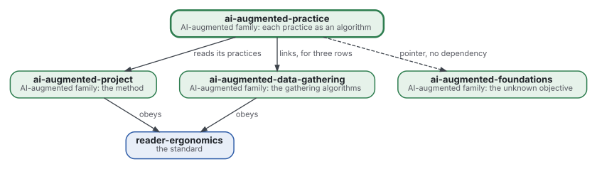
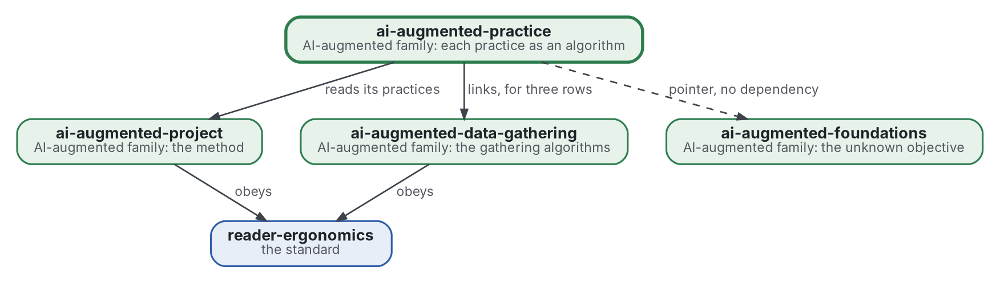

# Practice as algorithm

[](https://github.com/Tewf/ai-augmented-practice/actions/workflows/checks.yml)
[](https://tewf.github.io/ai-augmented-practice/)

Each practice of the AI-augmented method, read as an **algorithm** for a named problem. A page holds the practice, the problem class it solves, the best-known algorithm for that class with a reference implementation, the gap between the two, and the change proposed. One page per practice, and one table a program checks.

This page in French: [README.fr.md](README.fr.md).

> **Status (2026-11-03):** version 0.1.0. Built: the first pass of the review, 40 sources read by abstract or record, the
> twelve rows of the map each with a page, a table checked by a program with 16 unit tests, and a named baseline. Open:
> no full text read, no proposed change run on a real case, and the data-gathering rows wait for that repository's own
> review. The field has no single name for this, and the name stays. It is not an official standard, not a
> peer-reviewed study and not a new result.
>
> **How it is made:** with Claude, an AI assistant by Anthropic, under the maintainer's direction, the way
> reader-ergonomics was made. Corrections are welcome as issues.

## Where it sits



<details>
<summary>Graphviz source</summary>



</details>

- **It reads [ai-augmented-project](https://github.com/Tewf/ai-augmented-project)**: the method is that repository's, and each practice here is one of its practices.
- **It links [ai-augmented-data-gathering](https://github.com/Tewf/ai-augmented-data-gathering)** for the rows whose algorithm lives there, and points to [ai-augmented-foundations](https://github.com/Tewf/ai-augmented-foundations), which holds the theory of the unknown objective, without depending on it.
- **It obeys [reader-ergonomics](https://github.com/Tewf/reader-ergonomics/blob/4f99372093729dacf982e9174e94f6b8793c513d/standard.md)** (v1.20.0) and runs its checks in CI.
- **It links down only.** The family's map is [ai-augmented](https://github.com/Tewf/ai-augmented).

## Scope

| | What | Why |
|---|---|---|
| in | the map: one row per practice, with its problem class, best-known algorithm, reference implementation, gap and proposed change | a practice that is an algorithm can be compared with the best one; one table keeps the comparison in one place |
| in | the check of the map: a program that fails on an empty cell, a missing link or a row with no reference | a table nobody checks goes stale, and the family's rule is that a program checks what it can |
| in | one page per practice, opened from its row | a row holds the verdict; the page holds the reasoning behind it |
| later | each proposed change run on a real case | a change is a claim until a case measures it; the cases are [ai-augmented-cases](https://github.com/Tewf/ai-augmented-cases)' |
| out | the algorithms themselves, with their code | each lives in its own repository and is linked from its row |
| out | the method the practices belong to | [ai-augmented-project](https://github.com/Tewf/ai-augmented-project) |
| out | the theory of an objective that is not known in advance | [ai-augmented-foundations](https://github.com/Tewf/ai-augmented-foundations) |

## The map

Twelve rows, one page each: [the map](map/README.md). The practice is the maintainer's, written down for this review.

| Practice | Problem class | Algorithm | Fit |
|---|---|---|---|
| [scope and review](map/scope-and-review.md) | sequential decision problem | knowledge gradient | partly |
| [data gathering](map/data-gathering.md) | information foraging | marginal value rule, Thompson sampling | algorithm |
| [stopping](map/stopping.md) | estimating what is still unseen | coverage estimation | algorithm |
| [snowballing](map/snowballing.md) | traversal of a citation graph | citation chasing, ranked frontier | algorithm |
| [paywalled sources](map/paywalled-sources.md) | value of information | expected value of information | algorithm |
| [deep reading](map/deep-reading.md) | active learning | uncertainty sampling | algorithm |
| [runs per arm](map/runs-per-arm.md) | sequential testing, factorial design | confidence sequences | algorithm |
| [tiers](map/tiers.md) | multi-fidelity optimisation | Hyperband, model cascade | algorithm |
| [batches](map/batches.md) | scheduling with precedence | list scheduling, critical path | algorithm |
| [the budget cap](map/the-budget-cap.md) | allocation under a budget | cost-aware Bayesian optimisation | partly |
| [protocol before the run](map/protocol-before-the-run.md) | preregistration | registered report | algorithm |
| [memory](map/memory.md) | transfer | memory tiers over case-based reasoning | habit |

## What the map found

The first pass, 40 sources, read by abstract or record. Sources and grades are on each page.

- **No field names the whole.** Sequential decision analytics (Powell 2019) names the decision rows, and the automation of systematic reviews (Marshall 2019) names rows 2 to 6 ([frame](evidence/frame.md)). The name stays.
- **Eleven of twelve rows have a named problem and an implementation.** Memory is a habit: the field has designs, and no measure of notes kept by a person. Scope and the budget cap are posed but lack the data to run a policy.
- **The gap is mostly records, not a better algorithm.** Ten of the twelve changes begin by writing down a quantity the algorithm needs. Examples are yield per search string, the tier tried, and each job's predecessors.
- **Ten runs per arm detect only large effects.** Computed here. At ten runs per arm, power is 0.63 for a rate rising from 0 to 0.5, and 0.14 for 0.5 to 0.8. At sixty, it is 0.91 for 0.5 to 0.8, and 0.31 for 0.5 to 0.65 ([runs per arm](map/runs-per-arm.md)).
- **People against algorithms.** Mechanical prediction was about 10% more accurate than clinical judgment, and clinical judgment was substantially better in 6% to 16% of studies (Grove 2000, abstract). Intuition holds in regular environments with feedback (Kahneman 2009). So the choice of reading depth, the inclusion of a paper and what to note stay with the person.

## The baseline

**B1: protocol before the run.** The practice already is the field's procedure, preregistration (Nosek 2018): the plan and the prediction are written first and a program judges the run. The gap is a third-party timestamp and a list of deviations, the gaps Claesen 2021 found: every study of its sample deviated from its plan, and all but one left a deviation undisclosed (abstract). It is the one row where the maintainer's practice and the best-known procedure coincide in form ([protocol before the run](map/protocol-before-the-run.md)).

## Questions the review answered

- **Algorithm or habit.** Nine rows are algorithms, two are posed but unrun, and one, memory, is a habit.
- **The gap.** Measured by what the change would record; no gap is yet in hours or tokens, because the records do not exist.
- **People against algorithms.** See the findings above; judgment is left alone where the environment is irregular.
- **The check.** A program reads that each row has a problem, an algorithm with a key that resolves, a GitHub link and a change. It cannot decide that an algorithm is the best known ([the table check](checks/local/map_table.py)).

## Check it

```sh
git clone https://github.com/Tewf/reader-ergonomics
python3 reader-ergonomics/checks/run.py path/to/this/repository
python3 -m unittest discover -s checks   # the table check's tests
```

CI runs the same checks on every push, and a run fails on any error
([checks.yml](https://github.com/Tewf/ai-augmented-practice/blob/master/.github/workflows/checks.yml)). Every push to
master also renders the site, [tewf.github.io/ai-augmented-practice](https://tewf.github.io/ai-augmented-practice/)
([pages.yml](https://github.com/Tewf/ai-augmented-practice/blob/master/.github/workflows/pages.yml)).

## Contents

| Part | Summary |
|---|---|
| [map](map/) | twelve practices, each read as an algorithm for a named problem, with a table a program checks |
| [evidence](evidence/) | the frame, the protocol and the bibliography of 40 sources |
| [decisions](decisions/) | one record per choice that shapes this repository |

## Licence

Code under the [Apache License 2.0](LICENSE); prose under [CC BY 4.0](LICENSES/CC-BY-4.0.txt). Reuse it as you wish,
with credit to this repository; [CITATION.cff](CITATION.cff) gives a citation if you need one.
